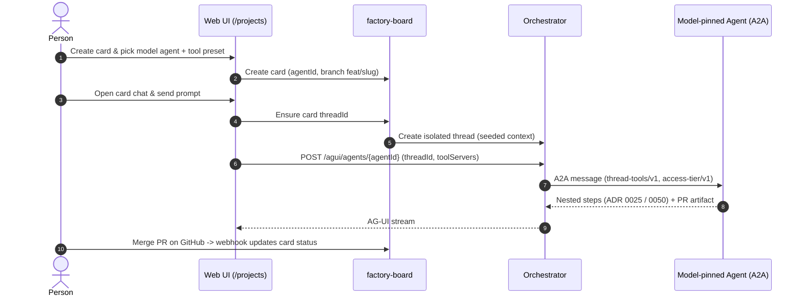
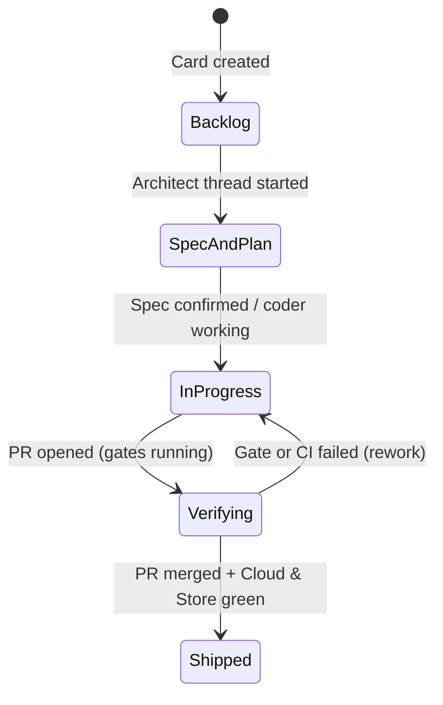

# ADR 0072 — App Factory board outside the orchestrator, and model selection by pinned agent services

- **Status:** proposed (2026-11-18). Decides the orchestration boundary for the mobile-app and cloud-backend factory ([app-factory plan](../plans/app-factory-mvp-2026-12.md)). Does not amend invariants 1 or 3 of [`CLAUDE.md`](../../CLAUDE.md); keeps [`ADR 0063`](0063-an-openai-compatible-model-endpoint-per-thread-on-the-orchestrator.md) and `another-adam-rs` [`ADR 0045`](https://github.com/vymalo/another-adam-rs/blob/main/docs/decisions/0045-a-subagent-can-run-in-the-background-as-a-session.md) slices 3–8 deferred until after the initial release.

## Context

The App Factory needs four user-facing capabilities on top of `another-agentic-system`:

1. **A Kanban board** tracking generated apps, feature cards, git branches (`feat/<slug>`), pull request URLs, cloud deployment health, and Google Play / Apple TestFlight build status.
2. **Isolated feature chats**, one thread per Kanban card with no cross-feature context bleed.
3. **Model choice per feature card** (frontier reasoning vs fast coding vs low-cost utility).
4. **Specialist subagent execution** (schema/backend, mobile UI, cloud/store ops) visible in the chat activity panel.

Two constraints in this repository block putting the first version of all four directly into the orchestrator or implementing new wire extensions on a short schedule (*verified 2026-11-18 against this repository and `another-adam-rs`*):

- **Orchestrator invariants.** [`CLAUDE.md`](../../CLAUDE.md) invariant 1 ([ADR 0007](0007-protocol-only-dependencies.md)) and invariant 3 ([ADR 0001](0001-rust-state-machine-on-postgres.md)) keep the orchestrator protocol-only over one event log; [ADR 0064](0064-the-person-reaches-the-agent-and-links-their-github.md) states explicitly that *"the orchestrator is never told what a repository is"*. Storing `projects`, `work_items`, `branch_name`, `pr_url`, `deploy_status` and `store_status` in `orch-core` and `orch-store-postgres` would couple the orchestrator to Git, CI, Kubernetes and mobile app stores.
- **Unbuilt extensions.** [`docs/api/model-relay-v1.md`](../api/model-relay-v1.md) ([ADR 0063](0063-an-openai-compatible-model-endpoint-per-thread-on-the-orchestrator.md)) has *"Nothing is built"* in either the orchestrator or `another-adam-rs`, and [ADR 0067](0067-the-plan-to-librechat-grade-and-the-client-agnostic-rule.md) currently lists per-person model pickers under *"What stays out"*. Likewise, `another-adam-rs` [ADR 0045](https://github.com/vymalo/another-adam-rs/blob/main/docs/decisions/0045-a-subagent-can-run-in-the-background-as-a-session.md) has slices 1–2 merged (`adam-llm-agent/src/sessions.rs`), while slices 3–8 (mid-turn progress streaming, limits, `child-sessions/v1` extension) are not built. Meanwhile, nested A2A `ask_agent` steps ([ADR 0025](0025-nested-steps-events-carry-their-source-path.md), [ADR 0026](0026-agent-mentions-as-structured-references.md)) and folder subagents ([ADR 0050](0050-the-chat-has-sub-agents.md)) are already built and rendered in `web/`.

## Decision

1. **Keep Kanban and app metadata in a separate `factory-board` service.**
   - A standalone Rust service (`factory-board`, built with CrateStack + Authkestra JWT resource validation) owns `Project`, `BoardCard`, store pre-flight status, git branch, PR status, cloud rollout status and store release status, and links each card to an orchestrator `threadId`.
   - `factory-board` interacts with `another-agentic-system` solely through its documented HTTP/AG-UI APIs and receives GitHub/CI/deploy/store webhooks without altering `orch-core` or `orch-store-postgres`.
   - When configured (capability flag in runtime web config), `web/` renders the `/projects` portfolio and `/projects/[id]` Kanban view against `factory-board` and opens the orchestrator's existing `ChatShell` (`threadId = card.threadId`) as a slide-over isolated feature chat.

2. **Deliver model choices via model-pinned agent services, not `model-relay/v1`.**
   - Deploy distinct named agent services/channels (for example `adam-architect` pinned to a frontier reasoning model, `adam-coder-fast` pinned to a coding model, `adam-coder-budget` pinned to a low-cost model) via `AGENTS_FILE` or `another-agentic-platform` (`AgentService` + `ModelEndpoint`).
   - Note: [ADR 0049](0049-the-coder-is-shown-as-adam-agents-may-have-aliases.md) `aliases` resolve legacy names onto one canonical agent and are **not** used for distinct models; each model tier is its own agent id in `GET /api/agents`.
   - Each Kanban card stores its chosen `agentId` and can fork/continue onto another model-pinned agent using existing thread continuation ([ADR 0029](0029-forking-a-thread-copies-its-log.md)). [`ADR 0063`](0063-an-openai-compatible-model-endpoint-per-thread-on-the-orchestrator.md) stays *proposed* for later per-user token budgets (`M2`).

3. **Deliver subagent collaboration with existing A2A `ask_agent` + `ADR 0050` folders.**
   - Specialist agents (`architect`, `cratestack-backend`, `fespalier-mobile`, `cloud-store-ops`) are exposed over existing A2A `@mentions` ([ADR 0026](0026-agent-mentions-as-structured-references.md)) and `ADR 0050` folder subagents + already-merged `SessionTools`. Nested steps render via existing `ADR 0025` support; `another-adam-rs` ADR 0045 slices 3, 4 and 6 wait for a follow-up milestone.

4. **Gate mutating cloud/store MCP actions behind human step-up approval.**
   - By default, generated app repositories deploy to Kubernetes and push to Play Internal / TestFlight via GitHub Actions on PR merge to `main`.
   - Any MCP tool that triggers a cloud rollout or store release (`factory-mcp`) uses `authkestra-mcp`'s `HumanApproved` tier (RFC 8785 JCS parameter binding + WebAuthn/TOTP step-up), never unattended `auto` execution.

## Alternatives considered

- **Add `projects` and `work_items` tables inside `orch-store-postgres` (rejected).** Violates [ADR 0007](0007-protocol-only-dependencies.md) and [ADR 0064](0064-the-person-reaches-the-agent-and-links-their-github.md) by teaching the orchestrator about git branches, PRs, Kubernetes rollouts and mobile stores.
- **Build `model-relay/v1` ([ADR 0063](0063-an-openai-compatible-model-endpoint-per-thread-on-the-orchestrator.md)) and `another-adam-rs` ADR 0045 slices 3/4/6 immediately (deferred).** Adds substantial cross-repo protocol surface and puts the orchestrator in the path of every streamed model token before per-person billing (`M2`) is even enabled.

## Consequences

- **Easier:** `another-agentic-system` keeps invariants 1, 3 and 5 intact with zero new database migrations or protocol extensions required in the orchestrator; `factory-board` itself validates the `cratestack-pg` + `authkestra` + TypeScript client stack; per-card model choice works immediately through `GET /api/agents`.
- **Harder:** Deployment includes one extra stateless API + database (`factory-board`) when factory mode is enabled, and model choices are coarse per-agent deployments rather than arbitrary model IDs in a dropdown until `ADR 0063` is built. Also, while M1 run pods remain off by default (`runPods.enabled: false`), coding workspaces operate under trusted-team isolation only.
- **Required elsewhere:** The App Factory plan ([`docs/plans/app-factory-mvp-2026-12.md`](../plans/app-factory-mvp-2026-12.md)), the `vymalo/app-factory-blueprint` repository, and optional factory routes in `web/`.
