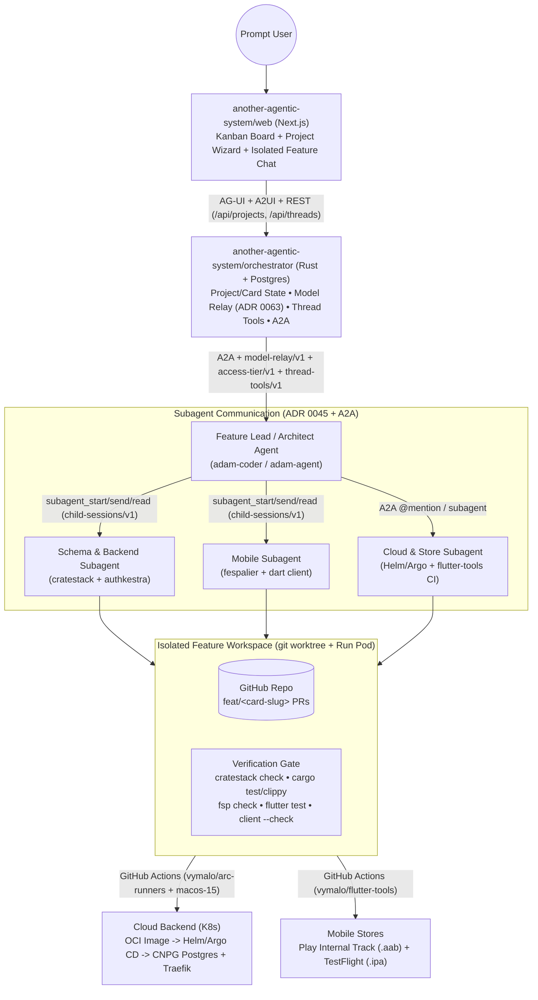
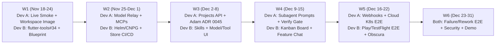

# App Factory MVP Plan (Nov–Dec 2026): Maintainable Mobile Apps & Cloud Backends

> **Status:** Proposed for review (`@stephane-segning`) — 2026-11-18  
> **Target Window:** 2026-11-18 to 2026-12-31 (~6 weeks)  
> **Team:** 2 Senior Engineers empowered by frontier AI coding agents (`/teamwork`)  
> **Backbone:** `another-agentic-system` + [another-adam-rs](https://github.com/vymalo/another-adam-rs) + [another-agentic-platform](https://github.com/vymalo/another-agentic-platform) + [another-agentic-images](https://github.com/vymalo/another-agentic-images)  
> **Generated App Stack:** [fespalier](https://github.com/fespalier/fespalier) (Flutter mobile UI) + [cratestack](https://github.com/cratestack/cratestack) (`.cstack` schema-first Rust server, offline SQLite, typed Dart client) + [authkestra](https://github.com/Authkestra/authkestra) (OIDC OP, passkeys, device-signed sessions)  
> **Delivery Targets:** Cloud K8s backend (OCI + Helm/GitOps + CloudNativePG + Traefik) & Store-ready mobile releases (Google Play Internal Track + Apple TestFlight via [flutter-tools](https://github.com/vymalo/flutter-tools))

---

## 1. Goal & Product Direction

Build a **prompt-driven, Kanban-orchestrated software factory** on top of the `vymalo/another-*` ecosystem that takes a user from a product prompt and feature cards to:
1. A **maintainable, schema-locked full-stack codebase** (Rust `cratestack-pg` + `authkestra` backend, single `.cstack` schema source of truth, `fespalier` file-routed Flutter mobile app with typed `cratestack generate-dart --preset fespalier` client and offline-first sync).
2. **Isolated feature development** where every Kanban card owns a dedicated isolated chat thread, git branch/worktree, model choice, tool bundle, and multi-agent execution trace.
3. **Automated cloud backend deployment** (OCI image build → Kubernetes Helm/GitOps deploy with CloudNativePG Postgres + Traefik TLS ingress + Authkestra endpoints).
4. **Automated store push** (GitHub Actions + `vymalo/flutter-tools` producing signed Android `.aab` → Google Play Internal Track and signed iOS `.ipa` → TestFlight).

---

## 2. Decisions Requiring Review (`@stephane-segning`)

### 2.1 Resolving `ADR 0063` vs `ADR 0067` on Model Choices
*Verified 2026-11-18 against this repository:*
- [ADR 0063](../decisions/0063-an-openai-compatible-model-endpoint-per-thread-on-the-orchestrator.md) and [`docs/api/model-relay-v1.md`](../api/model-relay-v1.md) (*proposed, nothing built*) specify `model-relay/v1` so users can choose a model per thread while keeping model keys out of agent pods.
- [ADR 0067](../decisions/0067-the-plan-to-librechat-grade-and-the-client-agnostic-rule.md) subsequently listed `"A model picker, presets, per-person model settings"` under *"What stays out"*.
- **Proposed decision:** Because per-feature **model choice** is a core requirement of this App Factory, we **adopt and implement `ADR 0063` (`model-relay/v1`)** as P0/P1 work and amend `ADR 0067`'s exclusion table when its PR lands.

### 2.2 Tactical Open Questions for Review
1. **New Blueprint Repository Name:** Should the golden starter template + domain skills (`fespalier` + `cratestack` + `authkestra` + Helm chart + `flutter-tools` workflows) live in a new repo `vymalo/app-factory-blueprint` (recommended for clean instantiation by `adam-coder`)?
2. **macOS Runner Routing for iOS TestFlight:** `vymalo/arc-runners` is `linux/amd64` only (*verified 2026-11-18* in [`arc-runners/Dockerfile`](https://github.com/vymalo/arc-runners/blob/main/Dockerfile)). Should generated app repos route `ios-build` + `testflight-submit` to GitHub-hosted `macos-15` runners while `android-build` + Rust backend builds run on self-hosted `vymalo/arc-runners`?
3. **Cloud Backend Target Cluster:** Should generated backends deploy to the same cluster pattern as [`deploy/chart/examples/netcup.values.yaml`](../../deploy/chart/examples/netcup.values.yaml) (Argo CD GitOps PR or `helm upgrade --install` from CI into a `factory-apps` namespace with CloudNativePG + Traefik)?

### 2.3 Hard Dec 31 Scope Boundary (Deferred to Jan 2027+)
To deliver a working end-to-end MVP by **2026-12-31** with 2 senior engineers + AI:
- **Deferred:** Self-service multi-tenant billing/quotas (`M2` limits, [#282](https://github.com/vymalo/another-agentic-system/issues/282)), full GDPR account deletion (`M5`, [#294](https://github.com/vymalo/another-agentic-system/issues/294)), multi-tenant user GitHub OAuth linking ([ADR 0064](../decisions/0064-the-person-reaches-the-agent-and-links-their-github.md), [#278](https://github.com/vymalo/another-agentic-system/issues/278)) — MVP uses org-scoped GitHub App installation tokens + per-feature branch/worktree isolation.
- **Deferred:** `another-agentic-platform` Operator K14 gVisor ([plat#54](https://github.com/vymalo/another-agentic-platform/issues/54)) & dynamic per-user cluster provisioning.
- **Deferred:** Full store **Production** review submission & automated store screenshot framing (`flutter-tools/actions/screenshots` + `app-store-submit` full metadata) — MVP ships **Play Internal Track + TestFlight** with pre-created store app IDs and secrets.
- **Deferred:** Remaining [ADR 0067](../decisions/0067-the-plan-to-librechat-grade-and-the-client-agnostic-rule.md) LibreChat-grade items (speech/voice, foreign conversation imports, live React/HTML artifact sandboxes).

---

## 3. Deep-Search Findings & Common Traps (*Verified 2026-11-18*)

Every finding below was verified directly against source files, ADRs, and open issues and must be cited in the corresponding GitHub tickets.

### 3.1 Backbone Findings (`vymalo/another-*`)

| Finding | Verified Evidence | Plan Action / Guardrail |
|---|---|---|
| **Orchestrator + Web MVP is mock-proven only** | [`README.md`](../../README.md), [`ROADMAP.md`](../../ROADMAP.md), [ADR 0037](../decisions/0037-the-mvp-is-complete-against-its-build-order.md): stateless Rust orchestrator on Postgres, AG-UI, A2UI (`catalog` v8), `thread-tools/v1`, `access-tier/v1`, forks ([ADR 0029](../decisions/0029-forking-a-thread-copies-its-log.md)), prompts ([ADR 0070](../decisions/0070-a-persons-prompt-library.md)), search ([ADR 0068](../decisions/0068-a-person-searches-their-own-threads.md)) are proven on WireMock / scripted models; no live LLM or GitHub.com run yet. | Run an immediate **P0 Live-Model & Real-GitHub Smoke Gate (`E2-T1`)** in Week 1 before stacking Kanban features on top. |
| **No Project / Kanban domain model exists** | `orchestrator/crates/core/src/` holds `ThreadRecord`, `Task`, `Step`, `Prompt`, `ToolServer`, with no `Project` or `WorkItem` (card) entity. | Add `projects` + `work_items` Postgres tables, pure `orch-core` types, and OpenAPI-first REST routes in [`docs/api/chat-api.yaml`](../api/chat-api.yaml) per [ADR 0067](../decisions/0067-the-plan-to-librechat-grade-and-the-client-agnostic-rule.md). |
| **Model Relay (`ADR 0063`) is 0% built** | [`docs/api/model-relay-v1.md`](../api/model-relay-v1.md) & [ADR 0063](../decisions/0063-an-openai-compatible-model-endpoint-per-thread-on-the-orchestrator.md) state *"Nothing is built"*. `ChatModel` in `orch-model-openai` is non-streaming text-only for utility tasks ([ADR 0035](../decisions/0035-utility-model-tasks.md)). | Build `ModelForwarder` port + `orch-surface-model-relay` + `adam-rs` `model-relay/v1` client + Composer model chip (`E3-T1`..`E3-T3`). |
| **Background Subagent Sessions (`adam-rs` ADR 0045) are 25% built (2/8 slices)** | [`ROADMAP.md`](../../ROADMAP.md) & [`another-adam-rs` ADR 0045](https://github.com/vymalo/another-adam-rs/blob/main/docs/decisions/0045-a-subagent-can-run-in-the-background-as-a-session.md): Slice 1 (`Runtime::start_child_continuing`, `list_sessions`) and Slice 2 (`SessionTools` in `crates/adam-llm-agent/src/sessions.rs`) are merged; **Slices 3–8 are not started**. | Scope Dec MVP to **Slice 3 (progress reports) + Slice 4 (limits) + Slice 6 (`child-sessions/v1` extension)** (`E4-T1`); defer remote sessions (Slice 5) & interactive child `ask_user` (Slice 8). |
| **Subagents inherit NOTHING by default** | [ADR 0050](../decisions/0050-the-chat-has-sub-agents.md): `ToolCtx::start_child` starts the child with only `{message}`; parent `thread-tools/v1` grants and context do not automatically travel to child agents. | Specialist subagent folders (`cratestack-backend`, `fespalier-mobile`, `cloud-store-ops`) must explicitly declare their own `tools:`/`mcp.json` and receive repo/branch/schema context in their handoff prompt (`E4-T2`). |
| **`adam-coder` OpenCode replacement (`adam-rs` ADR 0044) is 94% complete (16/17 slices)** | [`ROADMAP.md`](../../ROADMAP.md) (*checked 2026-11-16*): paged file/output reads, prompt cache prefix, plans, repo instructions, skills, compaction, typed `ask_user`, commands, and background commands are merged. Only Slice 17 (LSP) is in progress. | Reuse `adam-coder` worktrees, `run_checks`, `commit_and_push`, `open_pull_request`, plans, skills, and `ask_user`; add Dart LSP to `lsp/table.rs` (`E2-T3`). |
| **Workspace image lacks Android SDK, `fsp`, `cratestack-cli`, Dart LSP** | [`another-agentic-images/toolchains/install.sh`](https://github.com/vymalo/another-agentic-images/blob/main/toolchains/install.sh) runs `flutter precache --web --no-android --no-ios` and installs only `gopls`, `typescript-language-server`, `pyright` (plus Rust). Meanwhile [`arc-runners/Dockerfile`](https://github.com/vymalo/arc-runners/blob/main/Dockerfile) bakes `cratestack-cli`, `flutter_rust_bridge_codegen`, Android SDK, Ruby/Fastlane, kubectl, helm, argocd. | Add an `app-factory` workspace image variant in `another-agentic-images` (`E2-T2`) baking pinned `fsp`, `cratestack-cli`, `sqlx-cli`, `helm`, `kubeconform`, and Android build-tools under `/opt` & `/cache`, leaving heavy iOS/Android signing builds to GitHub Actions (`arc-runners` + `macos-15`). |

### 3.2 Generated App Stack Findings (`fespalier` + `cratestack` + `authkestra` + `flutter-tools`)

| Finding | Verified Evidence | Plan Action / Trap Avoidance |
|---|---|---|
| **Reference `fespalier` + `cratestack` + `authkestra` integration already exists** | [`fespalier/docs/cratestack.md`](https://github.com/fespalier/fespalier/blob/main/docs/cratestack.md), [`fespalier/examples/cratestack/README.md`](https://github.com/fespalier/fespalier/blob/main/examples/cratestack/README.md), [`fespalier/examples/authkestra-op/README.md`](https://github.com/fespalier/fespalier/blob/main/examples/authkestra-op/README.md): `cratestack generate-dart --preset fespalier` emits a Dio-free Riverpod client wired to `fespalier`'s `HttpTransport`; `authkestra-op` + `authkestra-devsig` handle device-signed sessions, `@authn` step-up, and OIDC PKCE+DPoP. | Anchor every generated app on a deterministic `vymalo/app-factory-blueprint` (`E1-T2`) instead of letting agents invent custom routing/HTTP/auth glue. |
| **CrateStack CLI silent version drift** | [`cratestack-skills/skills/cratestack-cli/SKILL.md`](https://github.com/cratestack/cratestack-skills/blob/main/skills/cratestack-cli/SKILL.md): a stale `cratestack` earlier on `PATH` silently emits wrong code. CrateStack `0.20.0+` provides `CRATESTACK_REQUIRE_VERSION` / `--require-version`. | Pin `CRATESTACK_REQUIRE_VERSION` in the blueprint `Justfile`, workspace image, and CI drift check (`generate-dart --check`). |
| **CrateStack `IdempotencyLayer` vs `AuthProvider` ordering trap** | [`fespalier/examples/cratestack/README.md`](https://github.com/fespalier/fespalier/blob/main/examples/cratestack/README.md): `IdempotencyLayer` runs before `AuthProvider`, so unauthenticated or attestation-renewed requests collide across keys. | Blueprint server enforces idempotency *after* authentication inside procedures (or via L3 `OpExecutor` when stabilized), never via outer `IdempotencyLayer`. |
| **`fespalier_cratestack` vs `flutter_rust_bridge` tight pin** | [`fespalier/docs/cratestack.md`](https://github.com/fespalier/fespalier/blob/main/docs/cratestack.md): `cratestack_cbor` strictly pins `flutter_rust_bridge`. Passing `--no-native-cbor` uses pure-Dart `cbor`. | Default blueprint uses `--no-native-cbor` over `fespalier_cratestack` unless on-device `cratestack-sqlite` FFI is explicitly requested. |
| **Authkestra `rustls` crypto provider trap** | [`authkestra/README.md`](https://github.com/Authkestra/authkestra/blob/main/README.md): default `rustls-aws-lc-rs` compiles C/assembly and conflicts with pure-Rust / `cargo-deny` / `distroless` musl builds unless `rustls-no-provider` + `ring::default_provider().install_default()` is configured. | Bake `rustls-no-provider` + `ring` setup into blueprint `server/src/main.rs` and verify with `cargo deny`. |
| **`vymalo/flutter-tools` sharp edges** | 1. [`flutter-tools#34`](https://github.com/vymalo/flutter-tools/issues/34): `project-dir` defaults to `'mobile'` (silent wrong path for root apps). 2. [`actions/ios-build/README.md`](https://github.com/vymalo/flutter-tools/blob/main/actions/ios-build/README.md): `flutter#176636` requires `flutter build ipa --no-codesign` + `xcodebuild -exportArchive` (handled by `flutter-tools`). 3. [`actions/play-submit/README.md`](https://github.com/vymalo/flutter-tools/blob/main/actions/play-submit/README.md): Google Play's **very first** release must be uploaded manually before Play API `supply` can push to `internal`. 4. [`actions/screenshots/README.md`](https://github.com/vymalo/flutter-tools/blob/main/actions/screenshots/README.md): `integrationDriver` drops screenshots if `onScreenshot` is null, and Android needs `convertFlutterSurfaceToImage()`. | Fix `flutter-tools#34` first (`E1-T1`) and match blueprint directory layout (`apps/mobile`) explicitly in generated workflows (`E1-T4`). |

---

## 4. System Architecture

---

## 5. UI/UX Design: Kanban Board & Isolated Feature Chat

1. **Portfolio & Kickoff (`/projects`):**
   - Lists generated apps with live status badges (Cloud Backend `Healthy/Degraded`, Play Internal version, TestFlight build, Open PRs).
   - **"New App"** opens an A2UI Kickoff Wizard capturing App Name, Package/Bundle ID, Authkestra mode (OIDC / Passkey / Device-Sig), Core Entities, Cloud Namespace, and Store Targets. The `architect` agent instantiates the repo from `vymalo/app-factory-blueprint` and creates the initial Kanban cards.
2. **Kanban Board (`/projects/[projectId]`):**
   - **5 Columns:** `Backlog` → `Spec & Plan` → `In Progress` → `Verifying` → `Shipped`.
   - **Card Metadata:** Priority (`P0/P1/P2`), scope tags (`schema`, `backend`, `mobile`, `infra`), live status pill (`Agent Working`, `Needs Input` when an A2UI `ask_user` interrupt waits, `Checks Red/Green`, `PR #N`, `Cloud Healthy`, `Play #N / TF #N`), active subagent indicators.
3. **Slide-Over Isolated Feature Chat:**
   - Clicking a card opens its **1:1 isolated thread** (`thread_id` ↔ `card_id`) beside the board (reusing `ChatShell`, `Composer`, `ThreadPanel`).
   - **Zero cross-feature context bleed:** Each card's thread starts fresh, seeded only with the repo URL, isolated branch `feat/<card-slug>`, current `app.cstack`, and `lib/app/` tree summary.
   - **Per-Card Composer Controls:**
     - **Model Chip (`model-relay/v1`):** Grouped by tier (`Frontier Planner`, `Fast Coder`, `Budget`) based on agent card capabilities + `GET /api/me` roles.
     - **Tool Preset & Picker (`thread-tools/v1`):** Presets (`App Builder Full`, `Backend & Schema`, `Flutter UI`, `Deploy & Release`) + individual MCP toggles.
     - **Access Tier Chip (`access-tier/v1`):** `plan` | `edits` (default) | `auto` | `bypass`.
   - **Subagent Activity Drawer:** Nested step tree rendering `child-sessions/v1` progress for `cratestack-backend`, `fespalier-mobile`, and `cloud-store-ops`, with expandable transcripts and manual `Close / Reuse Session`.

---

## 6. Model Choices, Tool Selections & Subagent Communication

- **Model Routing (`model-relay/v1`, [ADR 0063](../decisions/0063-an-openai-compatible-model-endpoint-per-thread-on-the-orchestrator.md)):**
  - *Architect / `.cstack` & Authkestra security:* Frontier reasoning model.
  - *Feature Lead / `cratestack-backend` / `fespalier-mobile`:* High-throughput frontier coding model (user-selectable per card via Composer Model Chip).
  - *Utility ([ADR 0035](../decisions/0035-utility-model-tasks.md)):* Fast/low-cost model for thread titles, card summaries, and PR notes.
  - Subagents inherit the thread-scoped `model-relay/v1` token (never raw API keys).
- **Tool Selection (`thread-tools/v1` + Workspace Tools):**
  - *Workspace (in `app-factory-workspace` / `adam-coder`):* `read_file`, `edit_file`, `apply_patch`, `run_command`, Dart/Rust LSP diagnostics, `cratestack` (pinned), `fsp`, `cargo`, `flutter`, `helm`, `kubeconform`, `git-sandbox` + `github_mcp`.
  - *Orchestrator-relayed MCPs:* `factory-cloud-mcp` (K8s rollout, CNPG readiness, redacted pod logs), `factory-store-mcp` (GitHub Actions dispatch/runs, Play Internal & TestFlight status), `searxng-mcp`, `obscura` browser MCP ([ADR 0057](../decisions/0057-a-browser-agent-an-adam-folder-with-obscura-as-its-sidecar.md)).
- **Subagent Communication (`adam-rs` ADR 0045 + `child-sessions/v1`):**
  - Feature Lead (`adam-coder`) stays on `feat/<card-slug>` and coordinates local durable child sessions (`subagent_start`, `subagent_send`, `subagent_read`, `subagent_list`, `subagent_close`) for backend, mobile, and ops work, surfacing live progress frames via `child-sessions/v1` into the orchestrator event log and Feature Chat Activity panel.
  - Hard deterministic verification gate ([ADR 0002](../decisions/0002-verification-over-consensus.md), [ADR 0018](../decisions/0018-verification-gate-and-rework-loop.md)): PRs require `cratestack check`, `cratestack generate-dart --check`, `fsp check`, `cargo clippy/test`, `flutter test`, and `helm lint | kubeconform`.

---

## 7. GitHub Project v2 Board & Granular Ticket Backlog

### Board Schema (`vymalo` GitHub Project v2: `App Factory — Dec 2026 MVP`)
- **Columns (`Status`):** `Backlog`, `Ready`, `In Progress`, `In Review`, `Done`
- **Fields:** `Priority` (`P0`, `P1`, `P2`), `Size` (`XS`, `S`, `M`, `L`), `Track` (`Orchestrator/Rust`, `Adam/Agents`, `Images/Infra`, `Web UI/Kanban`, `Blueprint/Mobile-Store`), `Owner` (`Dev A`, `Dev B`), `Iteration` (`W1`–`W6`, Nov 18–Dec 31)

### Epic 1: Golden App Blueprint & Deterministic Verification (`vymalo/app-factory-blueprint` + `vymalo/flutter-tools`) — *Owner: Dev B*

| ID | Prio | Size | Week | Ticket | Verified Findings & Technical Scope |
|---|---|---|---|---|---|
| **E1-T1** | P0 | M | W1 | Fix `flutter-tools#34` (`project-dir` default) & verify `v0` store actions | Cite `vymalo/flutter-tools/issues/34` (`project-dir` defaults to `'mobile'`). Fix CLI/action default handling + tests, cut patch release. |
| **E1-T2** | P0 | L | W1 | Scaffold `vymalo/app-factory-blueprint` monorepo (`cratestack-pg` + `authkestra` + `fespalier`) | Model on `fespalier/examples/cratestack` + `examples/authkestra-op`. Includes `apps/server/` (`rustls-no-provider` + `ring`, post-auth idempotency, `/healthz`, `/readyz`), `apps/mobile/` (`fsp create`, `fespalier_cratestack`, `--preset fespalier --no-native-cbor`), `schema/app.cstack`, `Justfile` (`CRATESTACK_REQUIRE_VERSION`). |
| **E1-T3** | P0 | M | W1 | Blueprint Helm Chart & K8s deploy pipeline for generated backends | Model on `deploy/chart/examples/netcup.values.yaml` & `another-agentic-platform/deploy/operator`. Deploys Rust API + CNPG `Cluster` + Traefik `Ingress` + TLS + ExternalSecret/Secret env refs; `helm lint` + `kubeconform` in CI. |
| **E1-T4** | P0 | M | W2 | Blueprint CI/CD workflows: backend OCI + Play Internal + TestFlight | Combine `vymalo/arc-runners` (Linux: Cargo + Android AAB + `play-submit`) and `macos-15` (`ios-setup` + `ios-build` `flutter#176636` workaround + `testflight-submit`). Add PR drift/test gates. |
| **E1-T5** | P1 | S | W2 | Author `AGENTS.md` + blueprint skills (`cratestack`, `fespalier`, `authkestra`) | Vendor `cratestack-skills`, `Authkestra/skills`, and `fespalier` skills into `.agents/skills/` so `adam-coder` (`adam-rs` ADR 0044 slices 7–8) loads exact rules automatically. |

### Epic 2: Factory Workspace Image & Live-Stack Smoke Gate (`vymalo/another-agentic-images` + `another-agentic-system`) — *Owner: Dev A*

| ID | Prio | Size | Week | Ticket | Verified Findings & Technical Scope |
|---|---|---|---|---|---|
| **E2-T1** | P0 | M | W1 | Live-model & real-GitHub smoke test of `another-agentic-system` + `adam-coder` | Address `ROADMAP.md` (*"proven on mocks only"*). Run against a real OpenAI-compatible gateway + real test GitHub App repo; fix live integration mismatches. |
| **E2-T2** | P0 | M | W1 | Add `app-factory` workspace image in `another-agentic-images` | Extend `workspace/Dockerfile` (which currently uses `--no-android` and lacks `fsp`/`cratestack`): bake pinned `fsp`, `cratestack-cli`, `sqlx-cli`, `helm`, `kubeconform`, Android cmdline-tools/platform-tools under `/opt` & `/cache`. |
| **E2-T3** | P1 | S | W2 | Add Dart Analysis Server (`dart language-server`) to `adam-coder` LSP table | Extend `another-adam-rs/bin/adam-coder/src/tools/lsp/table.rs` (`adam-rs` ADR 0044 slice 17) so `file_diagnostics` works natively on Flutter/Dart files. |

### Epic 3: Model Choices (`model-relay/v1`) & Tool Selections (`another-agentic-system` + `another-adam-rs`) — *Owner: Dev A + Dev B*

| ID | Prio | Size | Week | Ticket | Verified Findings & Technical Scope |
|---|---|---|---|---|---|
| **E3-T1** | P0 | L | W2 | Implement `ModelForwarder` port & `orch-surface-model-relay` in orchestrator | Implement `docs/api/model-relay-v1.md` & `ADR 0063`: HS256 thread token (`aud: model-relay`, `mdls`, `mdl`), `POST /model-relay/{threadId}/v1/chat/completions` (SSE + usage ledger), `GET /v1/models`, role allowlists. |
| **E3-T2** | P0 | M | W2 | Implement `model-relay/v1` client support in `another-adam-rs` | Advertise `model-relay/v1` on AgentCard; route `adam-model-openai` calls to `{url}/v1` with thread token, suppress duplicate `usage/v1`, pass token to child sessions. |
| **E3-T3** | P1 | M | W3 | Web Composer Model Picker chip + `GET /api/agents/{id}/capabilities` model list | Update `web/src/features/chat/components/composer.tsx`; render chip when `model-relay/v1` is declared; persist per-card model pick; amend `ADR 0067` note. |
| **E3-T4** | P1 | M | W2 | Build `factory-cloud-mcp` & `factory-store-mcp` servers + tool preset profiles | Expose Streamable HTTP MCP tools (`ADR 0019`, `ADR 0024`, `authkestra-mcp`): repo creation from blueprint, K8s/CNPG status, GitHub Actions dispatch/runs, Play/TestFlight status. |
| **E3-T5** | P1 | S | W3 | Enhance Web `ToolsPicker` with Factory Tool Presets & per-card bindings | Extend `web/src/features/tools/components/tools-picker.tsx` & `use-thread-tools.ts` with preset bundles (`Full`, `Backend`, `Mobile`, `Deploy/Store`). |

### Epic 4: Subagent Communication & Specialist Agent Team (`another-adam-rs` + `another-agentic-system`) — *Owner: Dev A + Dev B*

| ID | Prio | Size | Week | Ticket | Verified Findings & Technical Scope |
|---|---|---|---|---|---|
| **E4-T1** | P0 | L | W3 | Complete `adam-rs` `ADR 0045` Slices 3, 4 & 6 (`reports`, `limits`, `child-sessions/v1`) | Build on existing Slices 1–2 (`adam-llm-agent/src/sessions.rs`): mid-turn child progress frames, depth/concurrency caps, `child-sessions/v1` A2A task metadata extension. |
| **E4-T2** | P0 | M | W3 | Author Specialist Subagents & Agent Folders (`architect`, `cratestack-backend`, `fespalier-mobile`, `cloud-store-ops`) | Follow `ADR 0050` (*"subagents inherit nothing"*): explicit `instructions.md`, `subagents/*.md`, `mcp.json`, and structured repo/branch/schema handoff contracts. |
| **E4-T3** | P1 | M | W4 | Orchestrator projection & Web Activity UI for live nested subagent sessions | Extend `orch-agui-projection` + `web/src/features/chat/components/steps/` to show `child-sessions/v1` progress, active subagent pills, expandable child transcripts, and `Close / Reuse Session`. |
| **E4-T4** | P1 | M | W4 | Harden multi-agent verification gate (`ADR 0018`) for full-stack PRs | Require commit-bound `checks` artifact covering `cratestack check`, `generate-dart --check`, `fsp check`, `cargo test`, `flutter test`, and `helm lint`. |

### Epic 5: Projects, Kanban Board UX & Isolated Feature Chats (`another-agentic-system`) — *Owner: Dev B + Dev A*

| ID | Prio | Size | Week | Ticket | Verified Findings & Technical Scope |
|---|---|---|---|---|---|
| **E5-T1** | P0 | L | W2 | Orchestrator `projects` & `work_items` Postgres schema, core & REST API | Add migration, `orch-core` types, and OpenAPI routes in `docs/api/chat-api.yaml` (`/api/projects`, `/api/projects/{id}/cards`, `/api/cards/{id}/move`, `/api/cards/{id}/thread`). |
| **E5-T2** | P0 | M | W3 | Isolated Feature Chat lifecycle: 1:1 thread creation, App-Context seeding & branch isolation | Lazily create `thread_id` bound 1:1 to `card_id`, seeded with repo URL, `feat/<slug>` branch, `app.cstack`, and `lib/app/` tree summary — zero cross-card context bleed. |
| **E5-T3** | P1 | L | W3–W4 | Web UI: `/projects` Portfolio + A2UI Project Kickoff Wizard | Build `/projects` route + A2UI Kickoff form driving `architect` agent to instantiate blueprint repo and seed initial Kanban cards. |
| **E5-T4** | P0 | L | W4 | Web UI: `/projects/[id]` Interactive Kanban Board + Slide-over Isolated Feature Chat | Build 5-column Kanban board (`web/src/features/projects/`) with live status badges and slide-over drawer hosting `ChatShell` (`threadId = card.threadId`) + Model/Tool/Tier chips. |
| **E5-T5** | P1 | M | W5 | GitHub Webhook & CI/Deploy/Store status sync back onto Kanban cards | Extend `POST /webhooks/github` (`ADR 0017`) to sync `pr_status`, `ci_checks`, `cloud_deploy_url`, and `store_release_status` onto cards live. |
| **E5-T6** | P2 | M | W5 | Automated headless Web preview (`obscura` / Flutter Web) inside Feature Chat artifacts | Capture Flutter Web render PNGs via `obscura` in CI/workspace and attach as artifacts (`ADR 0032`, `ADR 0058`). |

### Epic 6: End-to-End Integration, Store & Cloud Proof, & Hardening — *Owner: Dev A + Dev B*

| ID | Prio | Size | Week | Ticket | Verified Findings & Technical Scope |
|---|---|---|---|---|---|
| **E6-T1** | P0 | L | W5 | E2E Dry-Run: Prompt → Kanban → Backend & Mobile PR → Cloud K8s Deploy | Generate a 2-model app (`User` + `Note`/`Task` with Authkestra), merge PR, verify live K8s HTTPS endpoint + CNPG migrations + `/healthz`. |
| **E6-T2** | P0 | M | W5 | E2E Store Push Proof: Play Internal Track (`.aab`) + Apple TestFlight (`.ipa`) | Seed initial Play Console app + ASC app, run generated repo CI via `flutter-tools` and verify Play Internal + TestFlight build numbers sync to Kanban card. |
| **E6-T3** | P1 | M | W6 | Failure-recovery & Rework E2E: broken `.cstack` / `fsp` route / failing test | Verify `adam-coder` + subagents recover from `cratestack check`, `--check` drift, `fsp check`, and red CI via `ADR 0018` rework loop without breaking `main`. |
| **E6-T4** | P1 | M | W6 | Docs, Demo Runbook & Secret Hygiene Audit (`gitleaks`, log redaction, run-pod bounds) | Verify zero model keys, GitHub secrets, or Play/ASC credentials leak into Postgres logs, A2A traces, or web responses. |

---

## 8. 6-Week Execution Schedule (2026-11-18 to 2026-12-31)

| Week | Dates | Dev A (Orchestrator / Adam / Infra) | Dev B (Blueprint / Web UI / Mobile CI) | Milestone Exit Gate |
|---|---|---|---|---|
| **W1** | Nov 18–24 | `E2-T1`, `E2-T2` | `E1-T1`, `E1-T2` | Live LLM + GitHub smoke green; Blueprint compiles & passes tests |
| **W2** | Nov 25–Dec 1 | `E3-T1`, `E3-T2`, `E3-T4` | `E1-T3`, `E1-T4`, `E1-T5` | `model-relay/v1` works end-to-end; Blueprint deploys to staging K8s & builds AAB/IPA |
| **W3** | Dec 2–8 | `E5-T1`, `E4-T1`, `E2-T3` | `E3-T3`, `E3-T5`, `E5-T2` | Projects/Cards API live; Model & Tool chips live; `ADR 0045` slices 3/4/6 merged |
| **W4** | Dec 9–15 | `E4-T2`, `E4-T4` | `E5-T3`, `E5-T4`, `E4-T3` | Full Kanban Board + Slide-over Isolated Feature Chat + Subagent progress tree |
| **W5** | Dec 16–22 | `E5-T5`, `E6-T1` | `E6-T2`, `E5-T6` | Full Cloud K8s + Play Internal + TestFlight E2E green from Kanban prompt |
| **W6** | Dec 23–31 | `E6-T3`, `E6-T4` | `E6-T3`, `E6-T4` | Rework loop E2E, `gitleaks`/secret audit, Dec 31 launch demo ready |

---

## 9. Verification Plan

1. **Blueprint (`vymalo/app-factory-blueprint`):** `cratestack check`, `cratestack generate-dart --preset fespalier --no-native-cbor --check`, `cargo fmt --check && cargo clippy --all-targets -- -D warnings && cargo test --locked`, `fsp check && flutter test`, `helm lint && helm template | kubeconform -strict`.
2. **Orchestrator (`orchestrator/`):** `cargo fmt --all --check && cargo clippy --workspace --all-targets --locked -- -D warnings && cargo test --workspace --locked` (including `orch-surface-model-relay` and `projects`/`work_items` API tests).
3. **Web (`web/`):** `pnpm check && pnpm typecheck && pnpm test && pnpm build` + Playwright E2E (`pnpm test:e2e`).
4. **Live E2E Acceptance (`E6-T1`, `E6-T2`):** Prompt `/projects` Kickoff Wizard → Kanban cards → Isolated Feature Chat (model switch + tool preset + subagent progress) → PR merge → Live K8s HTTPS backend + Play Internal `.aab` & TestFlight `.ipa` release links on card.
